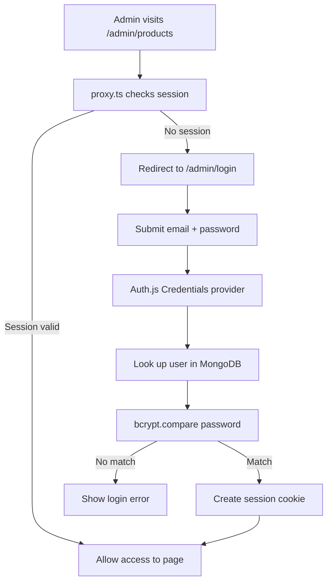

# Authentication Architecture

This document describes how admin authentication will work for Zenlora.

## Overview

| Piece | Responsibility |
| --- | --- |
| `proxy.ts` | Protects admin routes before the page loads |
| Auth.js | Handles login, logout, and sessions |
| MongoDB | Stores admin user records |
| bcrypt | Hashes and verifies passwords safely |

## `proxy.ts`

**What it is:** Next.js request proxy file (formerly middleware).

**What it will do:**
- Run on incoming requests before admin pages render
- Check whether an Auth.js session exists
- Allow public access to `/admin/login`
- Redirect unauthenticated users away from protected routes such as:
  - `/admin/dashboard`
  - `/admin/products`
  - `/admin/change-password`
- Optionally redirect already-logged-in users away from the login page

**What it will not do:**
- Store users
- Hash passwords
- Render the login UI

## Auth.js

**What it is:** Authentication library for Next.js (Auth.js / NextAuth).

**What it will do:**
- Power the admin login form (email + password via Credentials provider)
- Create and manage the session cookie after successful login
- Provide helpers such as `auth()` / `signIn()` / `signOut()`
- Support logout from the admin sidebar
- Support change-password flow after verifying the current password

**What it will not do by itself:**
- Automatically protect routes (that is `proxy.ts` / layout checks)
- Store users permanently (that is MongoDB)
- Hash passwords (that is bcrypt)

## MongoDB

**What it is:** Database used to persist admin account data.

**What it will store (example user document):**
- `email`
- `password` (hashed with bcrypt, never plain text)
- `name` / `role` (optional)
- timestamps such as `createdAt` / `updatedAt`

**What it will do:**
- Hold the admin user(s) Auth.js looks up during login
- Persist password hash updates after “Change password”
- Later store other app data if needed (products, orders, etc.)

**What it will not do:**
- Create sessions
- Protect routes
- Hash passwords on its own

## bcrypt

**What it is:** Password hashing library.

**What it will do:**
- Hash passwords before saving them to MongoDB
- Compare a login password with the stored hash using `bcrypt.compare`
- Make stolen database dumps much harder to abuse, because plain passwords are never stored

**Flow:**
1. Create/update admin password → `bcrypt.hash(password)` → save hash in MongoDB
2. Login → fetch user by email → `bcrypt.compare(input, storedHash)` → allow or deny

**What it will not do:**
- Manage sessions
- Protect routes
- Replace Auth.js or MongoDB

## How they work together

1. Admin opens a protected page
2. `proxy.ts` checks for an Auth.js session
3. If missing, redirect to `/admin/login`
4. Login form submits email + password to Auth.js
5. Auth.js finds the user in MongoDB
6. bcrypt verifies the password against the stored hash
7. Auth.js creates a session
8. `proxy.ts` allows access to admin routes on later requests
