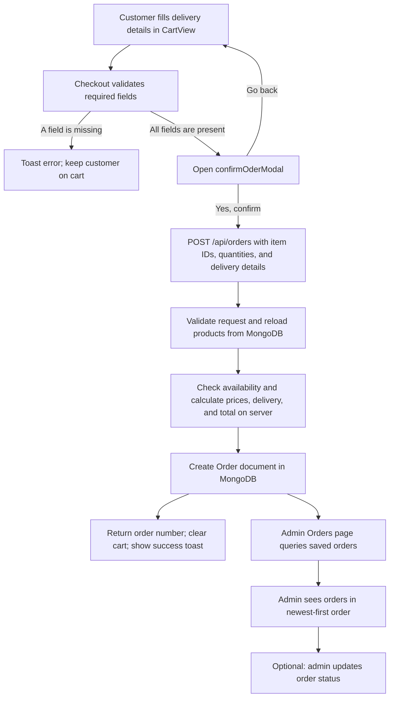

# Create and Store Orders

## Goal

When a customer confirms an order in the checkout confirmation modal, validate and save the order in MongoDB. Show saved orders in the admin area.

## Files to create

| File | Responsibility |
| --- | --- |
| `models/Order.ts` | Define the order document, including customer and delivery details, item snapshots, subtotal, delivery fee, total, status, and timestamps. |
| `lib/store-orders.ts` | Server-only order operations: validate and resolve products, calculate authoritative prices and totals, create orders, and query orders for admins. |
| `app/api/orders/route.ts` | Handle customer `POST` requests to create an order. Validate the request and return the saved order number or a safe error. |
| `app/admin/(panel)/orders/page.tsx` | Load orders from MongoDB and render the admin orders page. |
| `components/admin-orders-list.tsx` | Render the orders list and, if desired, expose admin actions such as changing order status. |

An admin-only update endpoint such as `app/api/admin/orders/[orderId]/route.ts` can be added when order status changes are implemented. A separate order detail page can be added if the admin needs full order details on a dedicated screen.

## Existing files to reuse or update

| File | How it fits |
| --- | --- |
| `components/common/cartView.tsx` | Keep the delivery form and required-field validation. Pass the cart and delivery details into the confirmation flow. |
| `components/confirmOderModal.tsx` | Keep the final confirmation prompt. Call the order API on “Yes, confirm,” show pending/error/success states, and prevent duplicate submissions while saving. |
| `context/cart-context.tsx` | Reuse cart contents and clear the cart only after the server confirms that the order was saved. Consider adding product IDs to cart items; the current cart identifies products by slug. |
| `models/Product.ts` | Read current product prices and inventory when creating an order. Never trust prices or totals sent by the browser. |
| `lib/delivery.ts` | Reuse `getDeliveryFee` to calculate delivery from the submitted city on the server. |
| `lib/mongoose.ts` | Reuse the existing MongoDB connection helper. |
| `components/common/sidebar.tsx` | Add an **Orders** link in the admin navigation. |
| `app/admin/(panel)/layout.tsx` | Reuse its admin role check to protect the new Orders page. |
| `app/admin/(panel)/dashboard/page.tsx` | Optionally show recent orders or order totals on the dashboard overview. |
| `components/providers.tsx` | Reuse the existing React Toastify container for order success and error messages. |

## Suggested order document

- Unique order number and status, initially `pending`.
- Optional customer account ID for signed-in customers; guest orders can omit it.
- A snapshot of full name, contact number, address, city, and ZIP code.
- Item snapshots containing product ID, product name, unit price, quantity, and line total.
- Subtotal, server-calculated delivery fee, and total.
- Created and updated timestamps.

Snapshots preserve what was ordered even if a product name or price changes later. The API accepts product identifiers, selected variant sizes, quantities, delivery details, an idempotency key, and the cart subtotal displayed to the customer. The server reloads products and calculates the final amounts itself; the submitted subtotal is only compared to detect a changed price and is never used as the saved total. Reusing an idempotency key with the same request returns the existing order, preventing duplicate orders after a retry. The API rejects missing products, invalid quantities, changed prices, or unavailable stock. The current implementation checks availability when the order is created but does not reserve or decrement inventory while the order is pending; add an atomic inventory reservation policy if orders need to reserve the last units against simultaneous checkouts.

## Request and display flow

The admin route is protected by the existing admin layout. If status updates are added, the update endpoint must independently verify the admin role as well; client-side navigation is not an authorization check.
