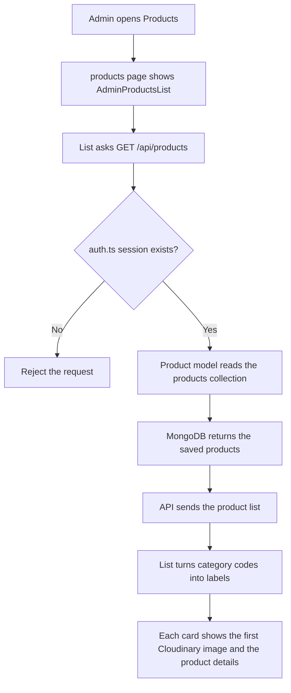

# List Products Architecture

This document describes how saved products appear in the admin product list.

No new file is needed. The list reads the same `products` collection that Save Product already writes.

## Overview

| Piece | Responsibility |
| --- | --- |
| `app/admin/(panel)/products/page.tsx` | The Products page the admin opens |
| `components/admin-products-list.tsx` | Asks for the saved products and draws one card for each |
| `app/api/products/route.ts` | `GET` handler that returns the products to a logged-in admin |
| `models/Product.ts` | Reads the product documents from MongoDB |
| `lib/mongoose.ts` | Connects to the same MongoDB database used when saving |
| `components/admin-category.tsx` | Turns stored category codes into the words shown on each card |
| `next.config.ts` | Allows the card image to load from Cloudinary |
| Auth.js | Confirms the request comes from a logged-in admin |

MongoDB stores the product text and the image URLs. The card shows the first URL. The image file stays in Cloudinary.

## Files to reuse

These files already exist. The list is wired into them. They are not rewritten from scratch.

| File | Role in this feature |
| --- | --- |
| `app/admin/(panel)/products/page.tsx` | Holds the page title, search bar, category filter, Add Product button, and the product list. |
| `components/admin-products-list.tsx` | Replaces the sample cards with the products returned by the API. Each card keeps its current layout. |
| `components/AddProductModal.tsx` | Stays on the page for Add and Update. |
| `components/common/button.tsx` | Active, Disable, Update, and Delete stay on each card. |
| `components/admin-category.tsx` | Supplies the labels for values such as `skincare` and `type:serum-oils`. |
| `components/admin-searchbar.tsx` | Stays above the list. |
| `app/api/products/route.ts` | Already saves a product with `POST`. A `GET` handler is added beside it to read the products. |
| `models/Product.ts` | The same product shape. `Product.find()` reads every saved product. |
| `lib/mongoose.ts` | Opens the Mongoose connection with `MONGODB_URI`. |
| `auth.ts` | `GET` calls `auth()` so only a logged-in admin can see the list. |
| `next.config.ts` | Adds `res.cloudinary.com` so Next.js can display the saved image URLs. |

No business-models folder is needed. The existing Mongoose product model reads the documents.

## What each card shows

The list reads these fields from each saved product:

| Field | What the card shows |
| --- | --- |
| `images` | The first Cloudinary URL, as the card photo |
| `name` | Product name |
| `isNewArrival` | New Arrival badge |
| `isOffer` | Offer badge |
| `category` | Main category label, such as Skincare |
| `subcategory` | Subcategory label, such as Serum / Oils or Moisturizers |
| `description` | Short description under the category |
| `price` | Original price |
| `discountedPrice` | Sale price, when one was saved |
| `discount` | Percent off |
| `quantity` | Stock count |

`category` and `subcategory` are stored as codes. `admin-category.tsx` turns those codes into the words on the card.

## How the list loads

1. Admin opens **Products**.
2. The page renders `AdminProductsList`.
3. The list calls `GET /api/products`.
4. The API route checks the Auth.js session.
5. If there is no session, the request is rejected.
6. The Product model reads the `products` collection.
7. The API sends those products back.
8. The list replaces the sample products and draws one card for each saved product.
