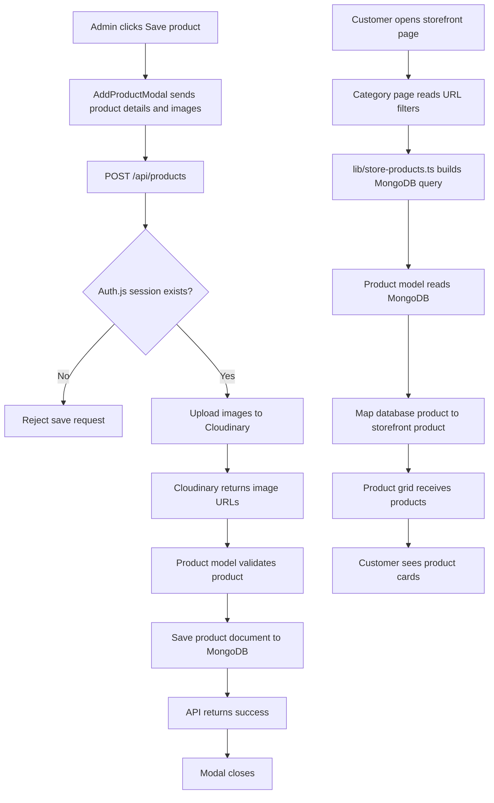
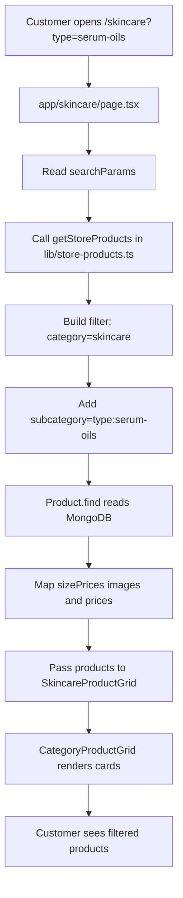

# Save and Show Products Architecture

This document describes the complete product flow:

1. An admin saves a product into MongoDB.
2. The storefront reads the saved product.
3. Customers see the product according to its category, subcategory, and flags.

The recommended storefront architecture uses server-side data fetching. The server reads MongoDB and passes the products to the existing client-side product grids. A separate public storefront API route is not required for this flow.

## Product flow overview



MongoDB stores the product text and Cloudinary image URLs. The image files themselves remain in Cloudinary.

## Admin save files

These files already exist and are reused for saving products:

| File | Responsibility |
| --- | --- |
| `components/AddProductModal.tsx` | Collects product details, category, subcategory, prices, images, and flags. Sends the form when the admin clicks Save Product. |
| `app/api/products/route.ts` | Handles the authenticated `POST` request and saves the product. It also contains the existing admin `GET`, `PATCH`, and `DELETE` handlers. |
| `models/Product.ts` | Defines the Mongoose product schema and calculates the discount percentage. |
| `lib/mongoose.ts` | Opens the shared MongoDB/Mongoose connection. |
| `lib/cloudinary.ts` | Uploads product images and returns Cloudinary URLs. |
| `auth.ts` | Allows only an authenticated admin to use the admin product API. |
| `.env.local` | Provides `MONGODB_URI`, database, and Cloudinary configuration. |

The admin product API must remain protected. Customers should not use `GET /api/products`, because that route currently requires an authenticated session.

## Storefront files to reuse

These existing files are used to display products to customers:

| File | Responsibility |
| --- | --- |
| `app/skincare/page.tsx` | Storefront skincare page. It will fetch skincare products and pass them to the grid. |
| `app/haircare/page.tsx` | Storefront haircare page. It will fetch haircare products and pass them to the grid. |
| `app/makeup/page.tsx` | Storefront makeup page. It will fetch makeup products and pass them to the grid. |
| `app/new-arrivals/page.tsx` | Storefront page that reads products where `isNewArrival` is `true`. |
| `app/offers/page.tsx` | Storefront page that reads products where `isOffer` is `true`. |
| `components/common/skincareProductGrid.tsx` | Receives skincare products and renders the shared grid. |
| `components/common/haircareProductGrid.tsx` | Receives haircare products and renders the shared grid. |
| `components/common/makeupProductGrid.tsx` | Receives makeup products and renders the shared grid. |
| `components/common/categoryProductGrid.tsx` | Renders product images, names, prices, badges, links, pagination, and add-to-cart actions. |
| `components/common/category.tsx` | Creates category and subcategory URL filters such as `?type=serum-oils` and `?concern=acne`. |
| `components/common/searchbar.tsx` | Creates the product search URL filter. |
| `components/common/productCartActions.tsx` | Adds a storefront product to the cart. |
| `context/cart-context.tsx` | Stores the customer cart in the browser. |
| `app/product/[slug]/page.tsx` | Loads one saved product for the product-detail page. |
| `components/common/productDetail.tsx` | Displays the product description, images, sizes, prices, stock, and cart controls. |
| `components/common/allProducts.tsx` | Currently contains hard-coded homepage and category sample products. Its static product arrays must be replaced or refactored to use database products. |
| `next.config.ts` | Already allows images from `res.cloudinary.com`. |

The category pages and product grids should continue to be used. They should receive database products as props instead of importing the hard-coded arrays from `allProducts.tsx`.

## New file for the recommended storefront flow

Create:

| File | Responsibility |
| --- | --- |
| `lib/store-products.ts` | Server-only product queries and mapping for the storefront. It reads MongoDB through `Product`, applies category/subcategory/flag filters, and returns frontend-ready product data. |
| `app/new-arrivals/page.tsx` | Customer-facing route for products marked as New Arrival. |
| `app/offers/page.tsx` | Customer-facing route for products marked as Offer. |

No new public API route is needed for the recommended architecture. The server pages call `lib/store-products.ts` directly.

If the storefront later needs browser-only fetching, infinite scrolling, or a Load More button, a separate read-only route can be added at `app/api/store/products/route.ts`. That is optional and is not part of the current recommended flow.

## Product data stored in MongoDB

`models/Product.ts` stores one document per product:

| Field | What it holds |
| --- | --- |
| `name` | Product name |
| `quantity` | Available quantity |
| `description` | Main product description |
| `keyBenefits` | Product benefits |
| `keyIngredients` | Product ingredients |
| `howToUse` | Usage instructions |
| `perfectFor` | Intended customer or skin/hair type |
| `seoMetaTitle` | SEO title |
| `seoMetaDescription` | SEO description |
| `seoSlug` | Product URL slug |
| `sizes` | List of product sizes |
| `sizePrices` | Size-specific prices, discounts, and image URLs |
| `inStock` | Whether the product is available |
| `brand` | Product brand |
| `format` | Product format |
| `aboutBrand` | Brand description |
| `shipping` | Shipping information |
| `category` | Main category, such as `skincare`, `haircare`, or `makeup` |
| `subcategory` | Stored as a value such as `type:serum-oils` or `concern:acne` |
| `isNewArrival` | New Arrival flag |
| `isOffer` | Offer flag |
| `createdAt` | Creation timestamp |
| `updatedAt` | Last update timestamp |

Images are stored inside `sizePrices[].images`. There is no separate `images` field in the Mongoose schema. The storefront mapper can flatten those image arrays for product cards and product details.

## Category, subcategory, and flag filtering

The admin form saves values like:

```text
category: "skincare"
subcategory: "type:serum-oils"
isNewArrival: true
isOffer: false
```

The storefront query should translate URL parameters into MongoDB filters:

| Storefront URL | MongoDB filter |
| --- | --- |
| `/skincare` | `{ category: "skincare" }` |
| `/haircare` | `{ category: "haircare" }` |
| `/makeup` | `{ category: "makeup" }` |
| `/skincare?type=serum-oils` | `{ category: "skincare", subcategory: "type:serum-oils" }` |
| `/skincare?concern=acne` | `{ category: "skincare", subcategory: "concern:acne" }` |
| New Arrivals page | `{ isNewArrival: true }` |
| Offers page | `{ isOffer: true }` |

Whether out-of-stock products are hidden is a storefront decision. If they should be hidden, add `inStock: true` and/or `quantity: { $gt: 0 }` to the query. Otherwise, show the product with an out-of-stock state.

## Storefront data flow

### Category and subcategory pages



The category sidebar and search bar remain client components because they update the URL. The page can then read the changed URL and load the matching products from MongoDB.

### Product-detail page

```mermaid
flowchart TD
  A[Customer clicks a product card]
  A --> B[Open /product/seo-slug]
  B --> C[app/product/[slug]/page.tsx]
  C --> D[Look up product in MongoDB through lib/store-products.ts]
  D --> E[Read name description sizes prices and images]
  E --> F[Pass product data to ProductDetail]
  F --> G[Customer views details and adds selected variant to cart]
```

The product detail page should use the saved `sizePrices` and image URLs instead of the current hard-coded sizes, images, and descriptions.

## Save flow

1. The admin opens **Add Product**.
2. `AddProductModal` collects the product fields.
3. The admin clicks **Save Product**.
4. The modal sends a `FormData` request to `POST /api/products`.
5. `app/api/products/route.ts` checks the admin session.
6. Product images are uploaded to Cloudinary.
7. `models/Product.ts` validates the product and calculates discounts.
8. The product document is saved to MongoDB.
9. The API returns success and the modal closes.

## Storefront display flow

1. A customer opens a category page.
2. The category page reads the category, subcategory, search, and flag filters from the URL.
3. The page calls `lib/store-products.ts` on the server.
4. `lib/store-products.ts` queries `Product` using the matching MongoDB filters.
5. The query result is converted into the product-card shape used by the frontend.
6. The category product grid receives the products as props.
7. `CategoryProductGrid` displays the image, name, sale price, discount, and badges.
8. Clicking a product opens `/product/[slug]`.
9. The detail page loads the full product from MongoDB and renders `ProductDetail`.
10. The customer can select a size and add the product to the existing cart.
