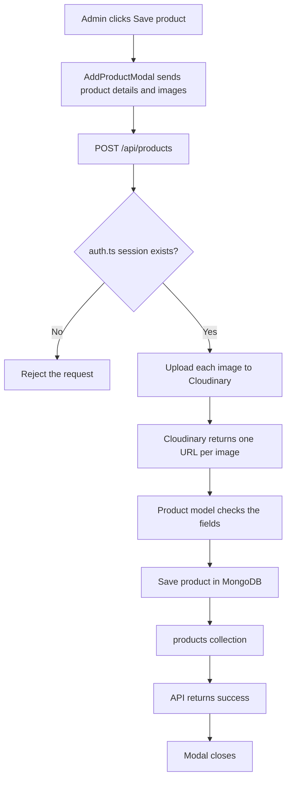

# Save Product Architecture

This document describes how an admin saves a product into MongoDB.

## Overview

| Piece | Responsibility |
| --- | --- |
| `AddProductModal` | Collects product details and sends them when Save is clicked |
| `app/api/products/route.ts` | Receives the save request and allows only a logged-in admin |
| `models/Product.ts` | Mongoose model that defines the product shape and writes it |
| `lib/mongoose.ts` | Connects Mongoose to the existing MongoDB database |
| MongoDB | Stores the product document |
| Cloudinary | Stores each product image file and returns a URL |
| Auth.js | Confirms the request comes from a logged-in admin |

MongoDB stores the product text and the image URLs. The image files stay in Cloudinary.

## Files to reuse

These files already exist. They are wired into the save flow. They are not rewritten from scratch.

| File | Role in this feature |
| --- | --- |
| `components/AddProductModal.tsx` | The Add Product form. The Save product button sends the form to `/api/products`. |
| `auth.ts` | The API route calls `auth()` so only a logged-in admin can save. |
| `.env.local` | Already has `MONGODB_URI`. The product connection uses that same database. |

No business-models folder is needed. The Mongoose product model is the only model for this feature.

## Files to create

| File | Role |
| --- | --- |
| `lib/mongoose.ts` | Opens one Mongoose connection using `MONGODB_URI`. |
| `models/Product.ts` | Describes a product and saves it to the `products` collection. |
| `app/api/products/route.ts` | `POST` endpoint that checks the admin session, then saves through the Product model. |

## Product model

`models/Product.ts` stores one document per product:

| Field | What it holds |
| --- | --- |
| `name` | Product name |
| `price` | Original price |
| `discountedPrice` | Sale price. Empty when the product has no discount |
| `discount` | Percent off, saved when the sale price is lower than the original price |
| `quantity` | Available stock |
| `description` | Text shown in the Description section |
| `images` | List of Cloudinary image URLs. A product can have more than one image |
| `sizes` | List of sizes the admin typed, such as `30 ML` and `100 ML` |
| `inStock` | Whether the product page shows In stock |
| `brand` | Brand shown in Additional information |
| `format` | Format shown in Additional information, such as Skincare |
| `aboutBrand` | Text shown in the About brand section |
| `shipping` | Text shown in the Shipping & Delivery section |
| `category` | Main category |
| `subcategory` | Subcategory under that category |
| `isNewArrival` | New Arrival flag |
| `isOffer` | Offer flag |
| `createdAt` | When the product was first saved |
| `updatedAt` | When the product was last saved |

`images` stores links only. It does not store the image files.

`sizes` is a list the admin builds by typing each size and adding it. There is no fixed size list.

## How a save works

1. Admin opens **Add Product** and fills in the form.
2. Admin adds one or more images, and adds each size by typing it.
3. Admin clicks **Save product**.
4. `AddProductModal` sends the details and image files to `POST /api/products`.
5. The API route checks the Auth.js session.
6. If there is no session, the save is rejected.
7. Each image is uploaded to Cloudinary, and the returned URLs are kept in `images`.
8. The Product model checks the fields, then writes one document into MongoDB.
9. The API tells the modal the save succeeded, and the modal closes.
