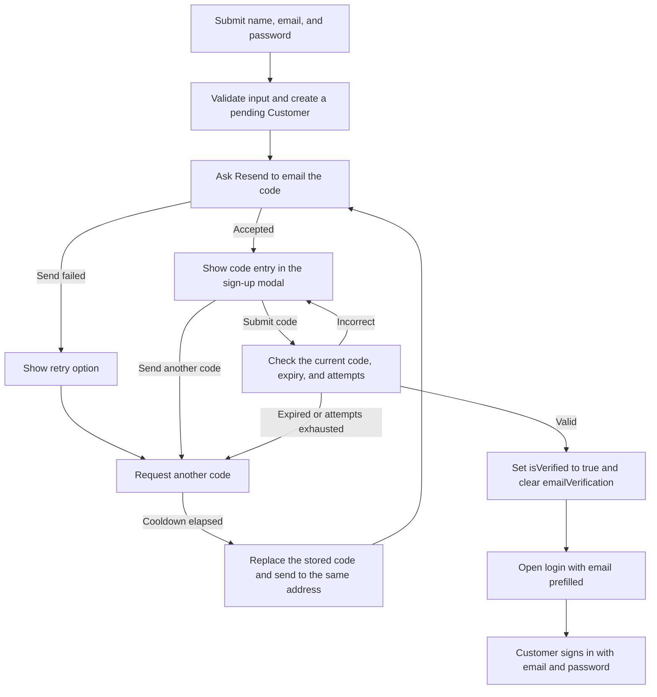

# Customer sign-up email verification

## Proposed design

Verify ownership of the submitted email address once, during customer sign-up. Today, `registerCustomer` creates a customer and immediately signs them in. With verification enabled, the same action will create a pending customer, send a six-digit code through Resend, and open the code-entry view. After verification, the customer will sign in with their password.

The existing `Customer` model represents the entire lifecycle. A separate `PendingRegistration` model would duplicate registration data and require moving it between collections.

## Verification functions and customer fields

In `models/Customer.ts`, `emailVerification` will hold the temporary data needed to check a code. The existing `isVerified` boolean will record whether the customer has successfully verified their sign-up email.

Two separate server actions in `lib/customer-auth.ts` will use those fields:

- `resendVerificationCode` will replace the pending code and request delivery. The customer's `isVerified` value stays `false`.
- `verifyCustomerEmail` will check the submitted code. Only a successful check will set `isVerified` to `true` and remove `emailVerification`, together in one database update.

## File plan

| Change | File | Responsibility |
| --- | --- | --- |
| Create | `lib/email/send-verification-code.ts` | Server-only Resend helper. Accept the customer's stored email and generated code, build the message, send it through the Resend SDK, and report whether Resend accepted the request. |
| Update | [models/Customer.ts](../models/Customer.ts) | Reuse `isVerified` and the unique email index. Add an optional `emailVerification` subdocument with no default value. |
| Update | [lib/customer-auth.ts](../lib/customer-auth.ts) | Reuse input validation, email normalization, and bcrypt hashing. Replace immediate sign-in after registration with code issuance. Add `verifyCustomerEmail` and `resendVerificationCode` server actions. A `customerAuth` dispatcher lets the modal share one `useActionState` state machine while preserving the separate verification functions. |
| Update | [auth.ts](../auth.ts) | In the customer Credentials provider's `authorize` callback, check for pending verification after validating the password and before issuing a session. Allow the login action to direct a pending customer back to verification. |
| Update | [components/common/login&signup-modal.tsx](../components/common/login&signup-modal.tsx) | Add a verification view showing the destination email, a six-digit input with paste and one-time-code autofill, a resend button, and error feedback. After success, open the login view with the email prefilled. |
| Reuse | [lib/mongoose.ts](../lib/mongoose.ts) | Use the existing MongoDB connection for registration, code rotation, and verification. |
| Configure | [package.json](../package.json), [package-lock.json](../package-lock.json), local and deployment environment | Install the `resend` SDK and supply the server-side settings described below. |

## Customer flow



## Verification state and retries

- **Issue a code.** Generate six digits with a cryptographically secure random generator. Store an HMAC of the customer ID and code using `VERIFICATION_CODE_SECRET`. Save the digest, `expiresAt`, `attemptsRemaining`, and `lastSentAt` under `emailVerification` in the same write that creates the customer. Only the email needs the plaintext code.
- **Check a code.** Start with a 10-minute lifetime and five guesses per code. Enforce both on the server. On success, atomically match the customer, current digest, unexpired deadline, and remaining attempts, then set `isVerified` and remove the subdocument. On an incorrect guess, atomically decrement the remaining attempts for that same code generation.
- **Send another code or recover.** Enforce a 60-second cooldown per normalized email across requests. Reserve the new delivery and replace the digest atomically before contacting Resend. Only the newest code is valid. If delivery fails, keep the customer pending and expose the retry path. Code expiry applies to the challenge only. A MongoDB TTL index on the customer document would delete the entire account.
- **Resume an interrupted sign-up.** A customer who closes the modal can enter their original email and password in the login view to resume verification. A repeated sign-up for an existing email should direct the user to login and preserve the stored password. Bind verification and resend to the registration that initiated the challenge or to a resumed attempt authenticated with that password.

## Existing customers

The current registration action leaves `isVerified` at its default of `false`. Use the presence of `emailVerification` to identify accounts that must finish this new flow. Existing customers without that field can continue to sign in. All newly registered customers must have the field from the moment their record is created until successful verification.

## Resend setup

### Create the API key

Open Resend's **API Keys** page and create a key named `Zenlora Development` or `Zenlora Production`. Use sending access and restrict the key to the production sending domain after that domain is available. Copy the key when it is displayed and store it only in server environment settings. [Resend API key permissions](https://resend.com/changelog/new-api-key-permissions)

### Configure local development

Add these values to `.env.local`:

```env
RESEND_API_KEY=re_your-resend-api-key
EMAIL_FROM="Zenlora <onboarding@resend.dev>"
VERIFICATION_CODE_SECRET=your-long-random-secret
```

Generate the verification secret once with `openssl rand -hex 32`. Keep the same value across deployments so pending codes remain valid. Restart `npm run dev` after changing the environment. The `onboarding@resend.dev` sender is for testing and generally delivers only to the email associated with the Resend account.

### Configure a production sender

After Zenlora obtains a custom domain, add it to Resend and add Resend's SPF and DKIM records through the domain's DNS provider. Replace `EMAIL_FROM` with an address on that verified domain, such as `Zenlora <verification@zenlorabd.com>`. A `vercel.app` deployment URL cannot be used as the sending domain because its DNS is controlled by Vercel. [Resend domain workflow](https://resend.com/changelog/new-domains-workflow)

### Configure Vercel

Add the same three variables under the Vercel project's **Settings → Environment Variables** for Preview and Production, then redeploy. Never expose the Resend API key or verification secret through a `NEXT_PUBLIC_` variable, client response, source control, or application logs.
