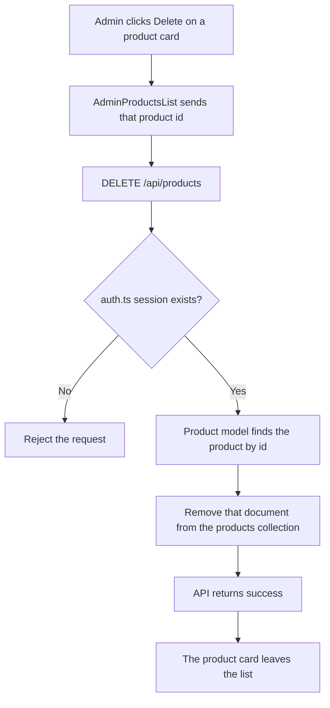
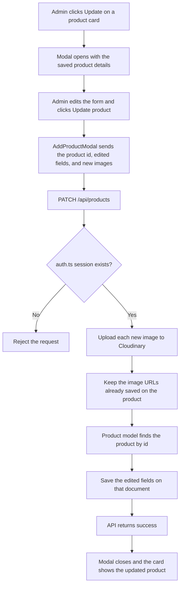

# Product Status Architecture

This document describes how an admin deletes a product and how an admin updates a saved product.

No new file is needed. Delete and update use the same `/api/products` route that already lists and saves products.

## Delete

### Overview

| Piece | Responsibility |
| --- | --- |
| `components/admin-products-list.tsx` | The Delete button on a product card sends that product's id |
| `components/common/button.tsx` | The Delete button the admin clicks |
| `app/api/products/route.ts` | `DELETE` handler on the existing products route |
| `models/Product.ts` | Finds the product by id and removes that document |
| `lib/mongoose.ts` | Connects to the same MongoDB database used when saving |
| Auth.js | Confirms the request comes from a logged-in admin |

MongoDB removes the product document. The image files can stay in Cloudinary.

### Files to reuse

These files already exist. Delete is added to them. They are not rewritten from scratch.

| File | Role in this feature |
| --- | --- |
| `components/admin-products-list.tsx` | Each card already has a Delete button. The click sends the saved product id to `DELETE /api/products`. |
| `components/common/button.tsx` | The same Delete button. It already accepts a click action. |
| `app/api/products/route.ts` | Already has `GET` and `POST`. A `DELETE` function is added in this same file. |
| `models/Product.ts` | Deletes one product document by its id. |
| `lib/mongoose.ts` | Opens the Mongoose connection with `MONGODB_URI`. |
| `auth.ts` | `DELETE` calls `auth()` so only a logged-in admin can delete a product. |

No business-models folder is needed. The existing Mongoose product model deletes the document.

### How a delete works

1. Admin opens **Products** and sees the saved product cards.
2. Admin clicks **Delete** on one card.
3. `AdminProductsList` sends that product's id to `DELETE /api/products`.
4. The API route checks the Auth.js session.
5. If there is no session, the delete is rejected.
6. The Product model removes that one document from the `products` collection.
7. The API tells the list the delete succeeded.
8. That card leaves the list.

## Update

### Overview

| Piece | Responsibility |
| --- | --- |
| `components/admin-products-list.tsx` | The Update button opens the product form with that product's saved details and id |
| `components/AddProductModal.tsx` | Shows the saved details. Update product sends the edited fields and the product id |
| `components/common/button.tsx` | The Update button the admin clicks on the card |
| `app/api/products/route.ts` | `PATCH` handler on the existing products route |
| `models/Product.ts` | Finds the product by id and saves the edited fields |
| `lib/mongoose.ts` | Connects to the same MongoDB database used when saving |
| Cloudinary | Stores any newly chosen image files and returns their URLs |
| Auth.js | Confirms the request comes from a logged-in admin |

MongoDB keeps the same product document and replaces its fields. Image URLs already stored on the product stay. New image files go to Cloudinary, and their URLs are added to `images`.

### Files to reuse

These files already exist. Update is added to them. They are not rewritten from scratch.

| File | Role in this feature |
| --- | --- |
| `components/admin-products-list.tsx` | Passes the product id and the saved fields into `AddProductModal`. After a successful update, the card shows the new details. |
| `components/AddProductModal.tsx` | Fills the form with the saved product. Update product sends the id, the edited fields, and any newly chosen image files to `PATCH /api/products`. |
| `components/common/button.tsx` | The Update button on the card. It already accepts a click action. |
| `app/api/products/route.ts` | Already has `GET`, `POST`, and `DELETE`. A `PATCH` function is added in this same file. |
| `models/Product.ts` | Updates one product document by its id. The discount is calculated again from the two prices. |
| `lib/mongoose.ts` | Opens the Mongoose connection with `MONGODB_URI`. |
| `lib/cloudinary.ts` | Uploads only the new image files. Existing Cloudinary URLs are left as they are. |
| `auth.ts` | `PATCH` calls `auth()` so only a logged-in admin can update a product. |

No business-models folder is needed. The existing Mongoose product model updates the document.

### How an update works

1. Admin opens **Products** and sees the saved product cards.
2. Admin clicks **Update** on one card.
3. `AddProductModal` opens with that product's saved name, prices, quantity, description, sizes, brand, images, category, and flags.
4. Admin edits the form and clicks **Update product**.
5. The modal sends the product id, the edited fields, and any new image files to `PATCH /api/products`.
6. The API route checks the Auth.js session.
7. If there is no session, the update is rejected.
8. Each new image is uploaded to Cloudinary. The URLs already saved on the product stay in `images`.
9. The Product model finds that document by id and saves the edited fields.
10. The API tells the modal the update succeeded, the modal closes, and the card shows the updated product.
